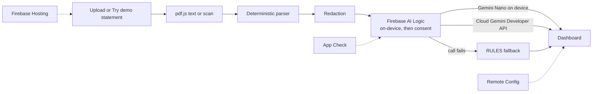

# CardLens

CardLens is a credit-card statement analyzer for the Firebase #BuildHybridAI 2026 hackathon. It reads a statement in the browser, categorizes transactions, and surfaces subscriptions, duplicate charges, and month-to-month changes. By default the statement stays on the device. A cloud call happens only after you agree, and only with redacted text or, separately, an image you agree to send. CardLens stays on the Firebase Spark plan and the Gemini Developer API free tier, so cloud analysis is turned off when the browser looks like the EEA, the UK, or Switzerland.

Hybrid inference goes through [Firebase AI Logic](https://firebase.google.com/docs/ai-logic/hybrid/web/get-started): Gemini Nano on device when Chrome's Prompt API can run it, the Gemini Developer API in the cloud otherwise, and local keyword rules if that call fails. App Check guards the cloud path. reCAPTCHA Enterprise is used only when `VITE_RECAPTCHA_ENTERPRISE_SITE_KEY` is set.

The demo statement is fictional. Names, the card number, the id, the phone, the email, and the address are invented test patterns.

## Repo layout

```
/web       Vite + TypeScript client. Parser, redaction, hybrid calls, dashboard.
/android   Kotlin + Jetpack Compose client. M0 skeleton (see below).
/shared    JSON Schema shared by both clients. Import these files; do not copy them.
/docs      Demo video script.
```

`shared/schema` is the contract. This tree does not change it.

## Architecture



| Stage | Where it runs | Mode |
| --- | --- | --- |
| PDF text extraction | Browser (`pdfjs-dist`) | Local |
| Scanned page or photo | On-device vision. After a separate image consent, and only if the region gate and kill switch allow it, one hybrid call | `ONLY_ON_DEVICE`, then `PREFER_ON_DEVICE` |
| Deterministic parse | Browser | Local |
| Redaction | Browser, before any model call that is allowed to reach the cloud | Local |
| Categorization | On-device only until consent. Then hybrid, else keyword rules | `ONLY_ON_DEVICE`, then `PREFER_ON_DEVICE` |
| Subscriptions and anomalies | Browser | Local |
| Month-over-month comparison | Browser | Local |
| Field extraction model | Constructed. The UI never calls `generateContent` on it | Same modes as the other models; never called |
| Insights | On-device only until text consent. Then hybrid, else a local template | `ONLY_ON_DEVICE`, then `PREFER_ON_DEVICE` |

A charge is a positive amount. A credit or refund is negative. Categorization prefers the on-device model. If that call falls back to the cloud, the prompt contains only redacted merchant strings. Card numbers, Israeli IDs, phones, emails, bank details, the cardholder name, and the address are stripped first. Keyword rules cover the same categories with no Firebase config and no network.

Subscriptions are detected on device: the same normalized merchant, a monthly or annual gap, and a similar amount. That sets `isRecurring` (installment plans and the subscriptions category still do too) and feeds a monthly cost estimate. Anomalies are also local: unusually large charges, near-duplicate charges, merchants that first show up in the latest month, foreign-currency charges, and fees.

Month-over-month comparison is local. It takes the two latest months, then shows each category's amount change and percent change. Percent is omitted when the previous month was zero. A subscription charged in only one of those two months is marked new or stopped. Remote Config can hide the section (`month_comparison_enabled`) or change the Notable threshold (`notable_delta_percent`, default 25). Both keys have those local defaults. A failed fetch keeps them.

Insights use the same hybrid mode. The model sees one redacted JSON aggregate (category and month totals, subscription summary, anomaly counts). No raw transaction lines go out. The screen badges the source as on-device, cloud, or rules. An on-device result is logged as not sent. If the call fails, a local template is shown and badged as rules.

Scanned images and image-only PDF pages cannot be text-redacted. On-device vision runs first. If it fails, an image dialog asks before any cloud send. The checkbox starts unchecked. Text PDFs never use that path. Offline, and in a restricted region, the image is not sent.

**What was sent to the cloud** lists every recorded payload in the session: the exact body, the redaction report, the source that came back, and the time. Offline, `navigator.onLine` pauses cloud calls. Text PDFs still parse, categorize with rules or the on-device model, and show template insights. The production build registers `web/public/sw.js` so the app shell can open again without a network.

## Where Firebase AI Logic is called

There is no cloud-only inference mode in `/web`. Without consent, or when the region gate or `cloud_fallback_enabled` is off, the call is `ONLY_ON_DEVICE` and a failure uses keyword rules. After you agree, and only when the region and the kill switch allow it, the call is `PREFER_ON_DEVICE`: the SDK tries the device first and may fall back to the cloud with that same already-redacted prompt. A thrown hybrid call is not retried. The cloud model name is `gemini-3.5-flash-lite`. Safety settings use `BLOCK_LOW_AND_ABOVE` for harassment, hate speech, sexually explicit content, and dangerous content. `selectInferenceMode` is the only place that chooses between those two modes. Its tests cover every combination of consent, region, and the kill switch.

| File | Function | Purpose | InferenceMode |
| --- | --- | --- | --- |
| `web/src/firebase.ts` | `getCardLensModels` | On-device categorization, extraction, insights, and scan models. Does not initialize App Check. | `ONLY_ON_DEVICE` |
| `web/src/firebase.ts` | `getHybridModels` | Hybrid models. Calls `ensureCloudAppCheck` first, which loads reCAPTCHA from `www.recaptcha.net` or the dev debug token. Used only after consent. | `PREFER_ON_DEVICE` |
| `web/src/firebase.ts` | `prepareOnDeviceModel` | `initializeDeviceModel` for categorization and for the scan model. No reCAPTCHA. | On-device models |
| `web/src/analyze/firebase-model.ts` | `firebaseOnDeviceMerchantModel` / `firebaseHybridMerchantModel` | `generateContent` for redacted merchant names. The hybrid function runs only after consent. | `ONLY_ON_DEVICE`, then `PREFER_ON_DEVICE` |
| `web/src/analyze/firebase-insights.ts` | `firebaseOnDeviceInsightsModel` / `firebaseHybridInsightsModel` | `generateContent` for the redacted aggregate. | `ONLY_ON_DEVICE`, then `PREFER_ON_DEVICE` |
| `web/src/scan/firebase-scan.ts` | `firebaseOnDeviceScanModel` / `firebaseHybridScanModel` | `generateContent` for a scan. The image is not redacted. Hybrid runs only after the image checkbox. | `ONLY_ON_DEVICE`, then `PREFER_ON_DEVICE` |
| `web/src/hybrid-demo.ts` | `runHybridDemo` | Sample merchants `WHOLE FOODS MARKET`, `SHELL OIL`, `NETFLIX.COM`, and `UBER TRIP`. Does not send a statement and does not fall back to the cloud. | `ONLY_ON_DEVICE` |

`web/src/main.ts` is the UI. **Try demo statement**, **Try scanned image**, and **Load sample statement** start the pipeline. **Download on-device model** calls `prepareOnDeviceModel` when Firebase and App Check allow it, and otherwise uses `LanguageModel.create` directly. It does not pick a different inference mode. `getAI` uses `GoogleAIBackend` and `useLimitedUseAppCheckTokens: true`.

The installed SDK (`firebase` 13.x) names the JSON Schema field `responseJsonSchema`. `responseSchema` is the OpenAPI-style helper, so the shared draft 2020-12 document is passed as `responseJsonSchema` (cloud) and `responseConstraint` (on-device).

Android calls Firebase AI Logic in one place, `android/app/src/main/java/io/cardlens/app/ai/FirebaseAiEngine.kt`. The model the screen uses is `InferenceMode.PREFER_ON_DEVICE`. If that hybrid call throws an on-device error instead of falling back, the engine retries once with `ONLY_IN_CLOUD`. See the Android section.

## Gemini Nano in Chrome

On-device inference needs Chrome 148 or newer.

1. Open `chrome://flags/#prompt-api-for-gemini-nano-multimodal-input` and set the flag to Enabled. Restart Chrome.
2. Hardware that can run the model: at least 22 GB of free disk, and either a GPU with more than 4 GB of VRAM or 16 GB of RAM with at least 4 CPU cores.
3. In CardLens, use **Download on-device model**. Chrome requires that user gesture before the Prompt API download. The first download can take several minutes.
4. The page reads availability from `LanguageModel.availability()` (the same check the hybrid Chrome adapter uses) in `web/src/device/availability.ts`. The badge is Available, Downloading, Downloadable, Not supported, or Unknown.

Without that setup the onboarding state is Not supported or Unknown. Keyword rules still categorize, and a configured cloud path can fall back to `gemini-3.5-flash-lite`. The hybrid demo tag then reads `IN_CLOUD`.

## Privacy and data flow

This matches `/privacy` (Variant B, Gemini free tier). The pages are drafts prepared by an AI assistant, not a lawyer. The publisher on those pages is Dash Buddies Games. Privacy, accessibility, and general contact use dashbuddies.games@gmail.com. No postal address is published. The full requirement table, payload shapes, and storage list are in [docs/compliance/E3-audit.md](docs/compliance/E3-audit.md).

What stays on the device:

- The PDF bytes, the extracted text, and any image you open. None of that is written to `localStorage`, IndexedDB, or Cache Storage by CardLens.
- Parsing, redaction, keyword categorization, subscription detection, anomaly detection, month comparison, and the local insight template.
- An on-device model call. The session log records it as not sent.

What redaction masks before a text model sees merchant names: card number (including spaced groups), card last 4 and masked partial numbers, Israeli ID, phone, email, IBAN, bank account, cardholder name, and address. Names and addresses are taken from header labels such as "Cardholder" and "Address", then removed wherever that same text repeats. The report counts replacements and does not echo the original values. Placeholders look like `[REDACTED_NAME]`. This is not a claim that the text is anonymous.

What may go to the cloud, only when Firebase is configured, App Check can run, the browser is online, the region gate allows it, and you agree:

- Redacted merchant strings, if on-device categorization throws.
- One redacted aggregate for insights, on the same condition. A text "yes" is remembered for the browser tab, with **Turn off cloud for this session**. Settings can switch to **Never use cloud**.
- A scanned image, only after its own dialog. The checkbox **I understand and want to send this image.** starts unchecked, and **Send image** stays disabled until it is checked. Agreeing to text does not agree to an image. The next image asks again.

On Google's free tier, Google may use that content to improve its products, and human reviewers may read it. The consent dialogs say so. Nothing is stored on a CardLens server. **Clear my data** deletes this browser's CardLens keys, Cache Storage, Firebase IndexedDB databases, and calls `deleteInstallations()` when Firebase is configured. It cannot delete something already sent to Google.

Cloud analysis is off, for both text and images, when any of these is true:

- A browser language region or IANA timezone is in the EEA, UK, or Switzerland set in `web/src/compliance/region.ts`. This still applies if Remote Config returns true. It can block someone who is not physically there (`en-GB`, `Europe/London`) and it can miss someone who is (`en-US` and `America/New_York` while physically in Berlin).
- Remote Config `cloud_fallback_enabled` was fetched and is not exactly true.
- Remote Config could not be fetched and the browser gave neither a language region nor a timezone.
- Remote Config could not be fetched and a restricted language or timezone is present.

A failed fetch with a clear non-restricted signal (for example `en-US` and `America/New_York`) leaves the parameter open. Consent is still required. The fetch interval is 5 minutes. The check is entirely in the browser. A VPN does not change `navigator.languages` or the timezone. Firebase's country condition, which uses IP, is the part only the Firebase console can add.

**What is sent to the cloud** is the in-memory session log. It shows the redacted payload or the image that was the model input. It is not uploaded anywhere by CardLens. There is no `console.*` in `web/src`, and no Analytics, Performance Monitoring, or Crashlytics import.

Offline mode follows `navigator.onLine`. The banner says cloud calls are paused. Text statements still parse and summarize. The production service worker caches the app shell (`./` and `./index.html`) so a later visit can open without a network. The dev server does not register that worker.

## Setup

Requirements: Node.js 22. On-device inference also needs the Chrome setup above.

```bash
cd web
npm ci
cp .env.example .env.local
npm run dev
```

`.env.example` lists empty placeholders only. Copy it to `.env.local` and fill the values from the Firebase console. `.env`, `.env.local`, and `.env.*.local` are gitignored. Do not commit keys, site keys, or debug tokens.

| Variable | Role |
| --- | --- |
| `VITE_FIREBASE_API_KEY` | Web app config |
| `VITE_FIREBASE_AUTH_DOMAIN` | Web app config |
| `VITE_FIREBASE_PROJECT_ID` | Web app config |
| `VITE_FIREBASE_STORAGE_BUCKET` | Web app config |
| `VITE_FIREBASE_MESSAGING_SENDER_ID` | Web app config |
| `VITE_FIREBASE_APP_ID` | Web app config |
| `VITE_RECAPTCHA_ENTERPRISE_SITE_KEY` | App Check. Set it to use reCAPTCHA Enterprise. Leave it empty in dev to use the debug token. |
| `VITE_APPCHECK_DEBUG_TOKEN` | Optional stable debug token for `npm run dev` only. Empty makes the SDK print a token to register. |

App Check, from `web/src/app-check-init.ts`:

- Site key set: `ReCaptchaEnterpriseProvider`.
- Dev and no site key: App Check still initializes so the debug token is exchanged. `ReCaptchaEnterpriseProvider` is not constructed. The debug token is installed only inside `import.meta.env.DEV` in `web/src/firebase.ts`, so a production build does not compile it in.
- Production with Firebase config but no site key: cloud model calls stay off. Parsing and rules still run.

Firebase project: register a web app, turn on AI Logic with the Gemini Developer API backend, and enforce App Check for AI Logic. Register the reCAPTCHA Enterprise site key for production. For local dev, run the app once, copy the debug token the SDK prints, and register it under App Check → Manage debug tokens. Add the deployed origin (and localhost only if you exercise the real provider locally) as an authorized domain. Hosting config is `web/firebase.json` and `web/.firebaserc` (project id `cardlens-hybrid`). Do not put API keys in those files.

| Script | What it does |
| --- | --- |
| `npm run dev` | Vite dev server |
| `npm run lint` | ESLint |
| `npm run typecheck` | `tsc --noEmit` |
| `npm test` | Vitest. No env vars required. |
| `npm run build` | Production bundle. Succeeds with no env vars set. |
| `npm run demo-fixtures` | Regenerates `web/public/demo/` from `web/scripts/make-demo-fixtures.mjs` |
| `npm run deploy` | Builds, then deploys Hosting only. Manual. Not run by CI. Do not deploy from this prep branch. |

With no `.env.local`, the app still parses a statement, categorizes it with keyword rules, detects subscriptions and anomalies, compares months, and writes template insights. The banner says Firebase or App Check is not configured.

**Try demo statement** fetches `web/public/demo/demo-statement.pdf` and runs it through the normal pipeline: pdf.js, the deterministic parser, redaction, categorization, insights. The PDF is English, covers August–October 2026, and includes a subscription that month comparison marks as new (Spotify, absent in September), a duplicate GETT charge, a negative refund, a euro charge, and header details redaction must mask. **Try scanned image** fetches `demo-statement-scan.jpg`, a slightly rotated, noisy rendering of that page, and sends it through the scan path. **Load sample statement** fills the dashboard from an in-memory fixture and does not read a file.

In `npm run dev` only, `?preview=available`, `downloadable`, `downloading`, `unsupported`, `unknown`, `comparison`, or `appcheck` paints those screens from the synthetic sample. Production builds omit that path.

## Spark plan

The web app is static Hosting plus client SDKs. `web/firebase.json` has no Cloud Functions. Remote Config and App Check are client APIs. Cloud Gemini runs only after consent, and only when Firebase and App Check are configured. Nothing in this repo requires the Blaze plan. Do not add Functions or other paid products for the demo. The project stays on Spark and the Gemini free tier on purpose, so the privacy policy uses Variant B and the EEA/UK/Switzerland gate above stays on.

### Remote Config condition (console)

Dash Buddies Games does this in the Firebase console. The client cannot create it.

1. Remote Config → add parameter `cloud_fallback_enabled`, Boolean, default `true`.
2. Add a condition whose country/region is the EEA countries plus the United Kingdom and Switzerland. Set `cloud_fallback_enabled` to `false` for that condition. Publish.
3. Do not turn on Remote Config personalization. Do not put secrets or statement text in a parameter.
4. The in-app default, used when the server has no value yet, is the string `true`. The browser language/timezone check still forces cloud off for a restricted browser.
5. App Check → enforce for Firebase AI Logic. Register a reCAPTCHA Enterprise **site** key and set `VITE_RECAPTCHA_ENTERPRISE_SITE_KEY` at deploy time. Do not commit it. The secret key must not be in the repo.
6. Restrict the Firebase web API key (HTTP referrers for the production origin and localhost, and only the Firebase APIs this app calls).
7. The legal pages name the publisher as Dash Buddies Games. Privacy, accessibility, and general contact use dashbuddies.games@gmail.com. No postal address is published.

Do not make this repository public from an agent session, and do not deploy from this branch.

## Demo fixtures

`web/scripts/make-demo-fixtures.mjs` rebuilds the PDF and the JPEG. The font it embeds is DejaVu Sans (`web/scripts/fonts/`), so the script does not depend on fonts installed on the machine. Run `npm run demo-fixtures` from `web/` after changing the statement lines, then update `web/src/parse/demo-statement.test.ts` if the expected rows change. The committed PDF is what the app and the test read.

## Android

`/android` is a Kotlin + Jetpack Compose M0 skeleton, package `io.cardlens.app`. It is not modified by the web demo work.

What is in the tree today:

- Hybrid categorization of a built-in sample, with an on-device or cloud badge. Model `gemini-3.5-flash-lite`, `InferenceMode.PREFER_ON_DEVICE`.
- On-device status, download with byte progress, and warm-up. Unsupported devices (the Android README uses a Pixel 6 Pro as the example) show that the on-device model is not available and the sample runs in the cloud.
- If a hybrid call throws an on-device error instead of falling back, `FirebaseAiEngine` retries once with `ONLY_IN_CLOUD`.
- App Check: Play Integrity in release, `DebugAppCheckProviderFactory` in debug. AI Logic uses limited-use tokens. Release code does not contain the debug provider.
- The app builds and runs without `google-services.json` and shows "Firebase not configured" instead of crashing. That file is gitignored.
- English UI. minSdk 26, compileSdk 37, targetSdk 37.
- Unit tests and `.github/workflows/android.yml` (JDK 17, `./gradlew assembleDebug lint testDebugUnitTest compileReleaseKotlin`). No Play publishing.
- No PDF import, parser, Room, or analytics yet.

`model/Transaction.kt` matches `shared/schema`. There is no second copy of the schema under `/android`. Setup steps for a device build are in `android/README.md`.

## Shared schema

`shared/schema/transaction.schema.json` is JSON Schema draft 2020-12 for one transaction: `date`, `merchant`, `amount`, `currency`, `category`, `isRecurring`. All six are required and `additionalProperties` is false. `amount` is a positive charge or a negative credit or refund. The `examples` array is fictional. `shared/schema/categories.json` is the category enum and must match `properties.category.enum`. Clients that send the schema to an on-device model omit `examples`. Installment plans are shown in the web UI only. They are not fields on the shared schema.

## Judges

No login. **Try demo statement** and **Load sample statement** use fictional English data. The site is English (`lang="en"`, `dir="ltr"`). The hosted URL, once deployed, should stay reachable without a paywall through 16 December 2026. This branch does not deploy.

## Pre-existing code

The statement parser, redaction, dashboard, service worker, and Android skeleton were already in this repository before the November 2026 legal and compliance pass. That pass added consent, the region gate, the legal pages, and the checks described in `docs/compliance/E3-audit.md`. Third-party notices are in [NOTICE](NOTICE).

## License

Apache-2.0. See [LICENSE](LICENSE).
